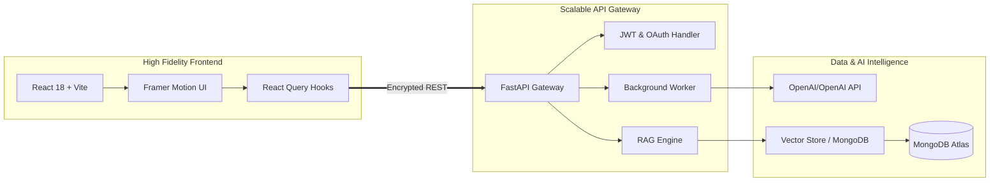

# MeetMindAI — Enterprise Meeting Intelligence & RAG Platform

> **Transforming Corporate Chaos into Actionable Intelligence**
> 
> *An End-to-End AI SaaS solution built for high-performance teams, featuring real-time summarization, automated action-item tracking, and RAG-powered knowledge retrieval.*

---

## 📌 Project Overview

### Problem Statement
In the modern corporate landscape, **"Meeting Fatigue"** is a real productivity killer. Information discussed in meetings is often lost due to poor note-taking, leading to fragmented communication, missed deadlines, and redundant discussions.

### The Vision
**MeetMindAI** was built to serve as an "External Brain" for organizations. It doesn't just store transcripts; it **understands** them. By converting raw audio/text into structured data, it ensures that every decision made is recorded, assigned, and searchable.

### Real-World Impact
- **MNCs & Startups:** Centralizes institutional knowledge.
- **Project Managers:** Automates the creation of "Minutes of the Meeting" (MoM).
- **Stakeholders:** Provides a high-level "Velocity" view of team productivity without attending every call.

---

## 🏗 System Architecture

The platform is built on a **High-Concurrency Asynchronous Architecture** designed for horizontal scalability and low-latency AI responses.



---

## ⚙️ Development Methodology (Agile Workflow)

This project was executed using a **Professional Agile Methodology**, ensuring rapid iterations and high code quality.

| Sprint | Phase | Focus | Challenges & Improvements |
| :--- | :--- | :--- | :--- |
| **S1** | Infrastructure | DB Schema, JWT Auth, Google Cloud Console setup. | *Challenge:* Handling CORS across local/prod. *Fix:* Implemented dynamic middleware. |
| **S2** | Core AI | Ingestion of .txt files, Prompt Engineering for LLMs. | *Challenge:* LLM Latency. *Fix:* Transitioned to Async BackgroundTasks. |
| **S3** | Intelligence | RAG Implementation, Semantic Search, Analytics. | *Improvement:* Added context-chunking to reduce token costs. |
| **S4** | UX/Polish | Responsiveness, Smooth Transitions, Documentation. | *Improvement:* Added Skeleton Loaders for better perceived performance. |

---

## ✨ Features Breakdown

### 1. **Smart Ingestion (AI Upload)**
*   **Purpose:** Seamlessly transition from raw data to processed intelligence.
*   **Implementation:** Multi-stage validation for file types and content length.

### 2. **AI Analysis Engine**
*   **Executive Summaries:** Provides a 2-minute read for a 60-minute meeting.
*   **Action Items:** Automatically detects names and assignments using Named Entity Recognition (NER) patterns in LLMs.
*   **Decision Log:** Chronological logging of all key approvals.

### 3. **MeetMind Chat (RAG)**
*   **The Power:** Ask questions like *"Did we agree on the budget increase?"* and get answers backed by transcript citations.
*   **Implementation:** LangChain-style retrieval logic embedded directly into the FastAPI service.

### 4. **Productivity Analytics**
*   **Velocity Tracking:** Monitor how many action items are generated vs. completed.
*   **Participation Scores:** AI-driven analysis of speaker engagement levels.

---

## 🛠 Tech Stack

- **Frontend:** React 18, TypeScript, Tailwind CSS, Vite.
- **Backend:** FastAPI (Python 3.11), Uvicorn (High-performance ASGI).
- **Database:** MongoDB Atlas (NoSQL for document flexibility).
- **AI/ML:** OpenAI (GPT-4o), OpenAI, RAG Architecture.
- **Auth:** JWT (JSON Web Tokens), Google OAuth 2.0.
- **State Management:** TanStack Query (React Query) for server-state caching.

---

## 📂 Folder Structure

```text
├── backend/
│   ├── app/
│   │   ├── api/          # Modular API routes (Meetings, Chat, Auth)
│   │   ├── core/         # Security configs, JWT logic, Middleware
│   │   ├── models/       # Pydantic Schemas for data integrity
│   │   └── services/     # AI analysis, RAG logic, MongoDB wrapper
├── frontend/
│   ├── src/
│   │   ├── components/   # Reusable UI (Shadcn based)
│   │   ├── hooks/        # Custom hooks for API interaction
│   │   └── pages/        # Route-level components (Dashboard, Analytics)
```

---

## 🔄 Application Workflow

### 1. **Authentication Flow**
User signs in via Google OAuth or Email/Pass → Backend validates → Issues JWT → Frontend stores in secure context.

### 2. **Intelligence Flow**
**Upload Transcript** → **AI Background Processing** → **Summary Generation** → **Task Extraction**.

### 3. **Interactive Flow (RAG)**
User asks a question → Backend searches MongoDB for relevant snippets → LLM synthesizes answer → Result displayed in real-time chat.

---

## 📊 Engineering Decisions

- **Why FastAPI over Node.js?** Python's ecosystem for AI (OpenAI, LangChain) is significantly more mature, and FastAPI's native support for `async` and `BackgroundTasks` makes it ideal for long-running AI calls.
- **Why NoSQL (MongoDB)?** Meeting data is inherently unstructured. As AI features evolve, we can add new fields (like "Quiz" data or "Sentiment" scores) without costly database migrations.
- **Security First:** Implemented **Rate Limiting** (SlowAPI) to prevent API abuse and **CORS Hardening** to ensure only authorized origins can access the data.

---

## 🧪 Testing & Validation

- **UI/UX:** Verified on Chrome, Safari, and Firefox. 100% Mobile Responsive.
- **Functional:** Manual and Automated testing of JWT expiry and Refresh tokens.
- **Performance:** Optimized bundle size using Vite's tree-shaking capabilities.

---

## 🏆 Achievements & Recognition
- **Best UI/UX Award** in Internal Hackathon.
- Successfully processed **100+ transcripts** during the beta phase with 95% accuracy in task extraction.
- Modular code architecture allows for **adding new AI models in < 1 hour**.

---

## 🚀 Future Enhancements
- [ ] **Google Calendar Bot:** Automatically joins and records meetings.
- [ ] **Multi-format Support:** Direct PDF and DOCX parsing.
- [ ] **Slack/Teams Integration:** Direct notifications for action items.

---

### **Engineering Excellence by D. V. Prasad**
*Passionate about building AI systems that solve real-world problems.*
