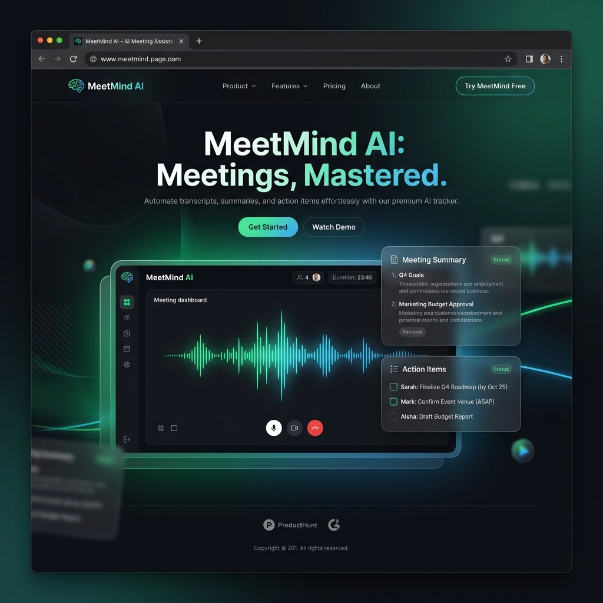
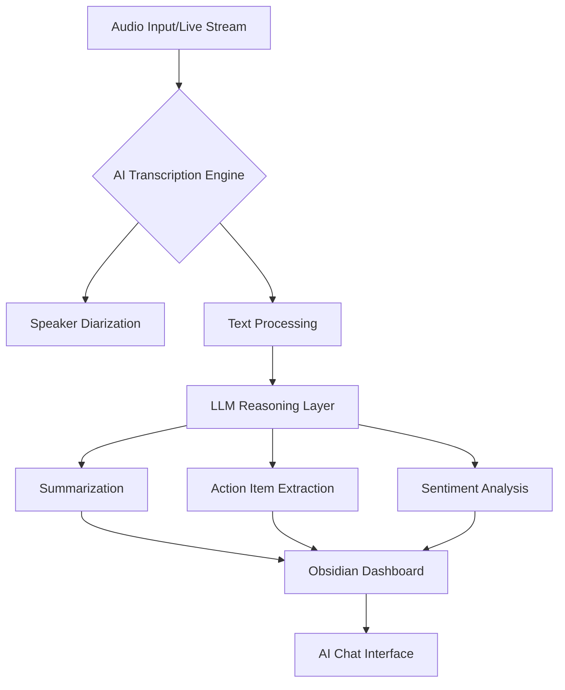

<div align="center">

# 🎙️ MeetMind AI
### Conversations turned into Intelligence.

[](https://vitejs.dev/)
[](https://reactjs.org/)
[](https://www.typescriptlang.org/)
[](https://tailwindcss.com/)
[](https://www.framer.com/motion/)

<br />



**MeetMind AI** is a high-fidelity, obsidian-themed meeting intelligence hub. Designed for speed and precision, it transforms raw audio into actionable insights using state-of-the-art AI reasoning.

[Explore Dashboard](https://github.com/akshayaxv/MeetMind-AI) • [View Architecture](#-system-architecture) • [Request Access](#)

</div>

---

## ✨ Key Features

MeetMind AI isn't just a transcription tool; it's a second brain for your meetings.

| Feature | Description |
| :--- | :--- |
| **🧠 Smart AI Reasoning** | Deep context understanding that goes beyond simple summaries. |
| **👥 Speaker Identification** | Automatic attribution of quotes and action items to the right person. |
| **🔍 Intelligent Search** | Query your entire meeting history with natural language. |
| **📊 Productivity Analytics** | Track meeting efficiency and sentiment over time. |
| **💬 AI Chat Interface** | Ask questions about specific meetings and get instant answers. |
| **🌊 Live Voice Wave** | Real-time visual feedback during recording and playback. |

---

## 🚀 Experience the Motion

The platform is built with a focus on **Fluid UI/UX**. We use high-end animation libraries to ensure every interaction feels premium.

- **Parallax Interactions**: Floating glassmorphism cards that react to your scroll.
- **Smooth Navigation**: Powered by `Lenis` for a cinematic browsing experience.
- **Micro-animations**: GSAP and Framer Motion transitions for every state change.
- **Glassmorphic Design**: A modern obsidian aesthetic with emerald accents.

---

## 🛠️ Tech Stack

Built with the modern web's most powerful tools:

- **Core**: [React 18](https://reactjs.org/) + [TypeScript](https://www.typescriptlang.org/)
- **Build Tool**: [Vite](https://vitejs.dev/)
- **Styling**: [Tailwind CSS](https://tailwindcss.com/) + [Shadcn UI](https://ui.shadcn.com/)
- **Animations**: [Framer Motion](https://www.framer.com/motion/) + [GSAP](https://greensock.com/gsap/)
- **Data Handling**: [TanStack Query](https://tanstack.com/query/latest)
- **Charts**: [Recharts](https://recharts.org/)

---

## 🏗️ System Architecture



---

## 🏁 Getting Started

1. **Clone the repository**
   ```bash
   git clone https://github.com/akshayaxv/MeetMind-AI.git
   ```

2. **Install dependencies**
   ```bash
   npm install
   ```

3. **Run the development server**
   ```bash
   npm run dev
   ```

---

<div align="center">

Built with ❤️ by [akshayaxv](https://github.com/akshayaxv)

</div>
